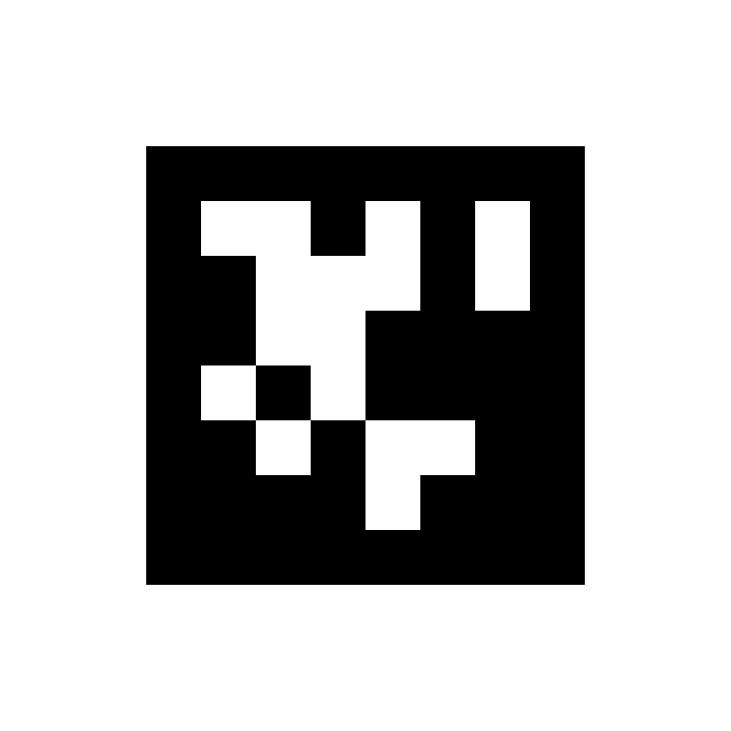
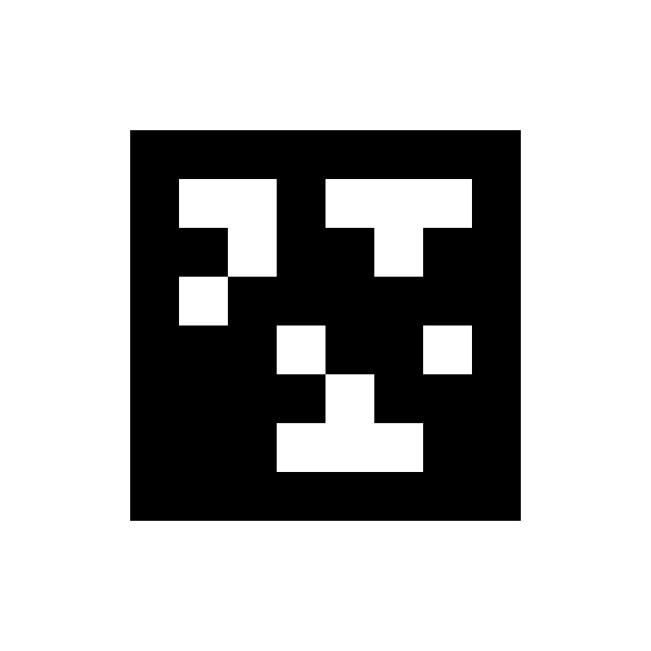
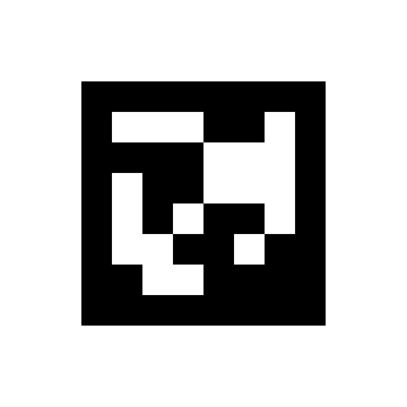

<div align="center">

# 🚜 Backflip Forklift

**An autonomous forklift rover that finds packages, reads their AprilTags, and sorts them into the right loading bay.**

ENGR 100-400 · University of Michigan · Fall 2026 · Team *Backflip*


</div>

---

## The challenge

The rover drives a course on its own, picks up packages of different shapes (spheres, cylinders, rectangular prisms and cubes), and drops each one in its assigned loading bay.

| Success criteria | Target |
|---|---|
| Packages sorted into the correct bay | 5 |
| Time limit | under 2 minutes |
| Malfunctions (drops) allowed | at most 1 |

## How it works

```
 ┌──────────────────┐   MJPEG over Wi-Fi   ┌───────────────────────────┐
 │ ESP32-CAM        │ ───────────────────▶ │ Laptop (Python + OpenCV)  │
 │ forward camera   │                      │  • grayscale frame        │
 └──────────────────┘                      │  • AprilTag detection     │
 ┌──────────────────┐                      │  • tag ID → package / bay │
 │ ESP32-CAM        │ ───────────────────▶ │  • steering decision      │
 │ downward camera  │                      └─────────────┬─────────────┘
 └──────────────────┘                                    │ TCP :5005
                                                         ▼  w / a / s / d / x
                          ┌─────────────┐   serial  ┌──────────────┐
                          │ Arduino Nano│ ◀──────── │ ESP32 relay  │
                          │ drive servos│           └──────────────┘
                          │ + MG90S net │
                          └─────────────┘
```

* **Identification.** Every package and bay carries an [AprilTag](https://april.eecs.umich.edu/software/apriltag) from the `tag36h11` family. The ID printed on the tag says what it is.
* **Vision.** Frames from the ESP32-CAM stream are converted to grayscale and passed to [`pupil-apriltags`](https://github.com/pupil-labs/apriltags). Each detection gives the tag ID, its four corners and its center in pixels.
* **Control (planned).** The laptop turns the tag's position into one-letter drive commands sent over TCP to an ESP32, which relays them to the Arduino Nano that drives the servos.
* **Handling.** A net driven by an MG90S servo carries the package.

## Repository layout

| File | What it is |
|---|---|
| [`aprilTags_advik.py`](aprilTags_advik.py) | Lightweight real-time AprilTag detector: reads a camera, outlines each tag in green, labels its ID, and prints detections. Tested on a laptop webcam. |
| [`ClaudeApriltags.py`](ClaudeApriltags.py) | More complete detector for the ESP32 stream: command-line options, MJPEG or snapshot mode, auto-reconnect, FPS overlay, optional pose estimation. Written with help from Claude. |
| [`AprilTags.py`](AprilTags.py) | Early scaffold for the robot loop: ESP32 video stream thread and TCP socket setup. |
| [`tags/`](tags/) | Printable `tag36h11` test tags, IDs 0 to 3 (`tags/raw/` holds the original 10×10 px images). |
| `requirements.txt` | Python dependencies. |

<p align="center">
  &nbsp;
  &nbsp;
  &nbsp;
  
  <br><sub>Test tags 0 to 3 (tag36h11)</sub>
</p>

## Quick start

```bash
git clone https://github.com/N-JJ26/Backflip-Forklift.git
cd Backflip-Forklift
python3 -m venv .venv
source .venv/bin/activate        # Windows: .venv\Scripts\activate
pip install -r requirements.txt
```

**Try it on your webcam.** Hold up one of the images in `tags/` (on a phone screen or printed):

```bash
python3 aprilTags_advik.py       # Esc to quit
```

**Run it on the robot camera.** Join the lab Wi-Fi first, then point it at the ESP32 stream:

```bash
python3 ClaudeApriltags.py --url http://<esp32-ip>/stream
# optional pose estimate (needs camera calibration):
python3 ClaudeApriltags.py --url http://<esp32-ip>/stream \
    --tag-size 0.05 --fx <fx> --fy <fy> --cx <cx> --cy <cy>
```

## Roadmap

- [x] Real-time `tag36h11` detection and on-screen overlay
- [x] Printable test tags
- [ ] Agree on the tag ID scheme (packages by shape, bays) and print final tags
- [ ] Test detection live on the rover's forward camera
- [ ] Map tag ID → package / bay in code
- [ ] Calibrate the camera so tag size gives distance
- [ ] Steer from the tag's position (`a`/`d`) and distance (`w`/`x`) over TCP
- [ ] Full autonomous pick-and-sort run

## Team

| Member | Focus |
|---|---|
| **Advik Agrawal** ([@advikagrawal8](https://github.com/advikagrawal8)) | Computer vision: AprilTag detection |
| **Nate Johnson** ([@N-JJ26](https://github.com/N-JJ26)) | Repository owner |
| **Eddie Graci** | Team member |
| **Joaquim Onofre Fioravanti** | Team member |

<sub>Built for ENGR 100-400 at the University of Michigan College of Engineering.</sub>
